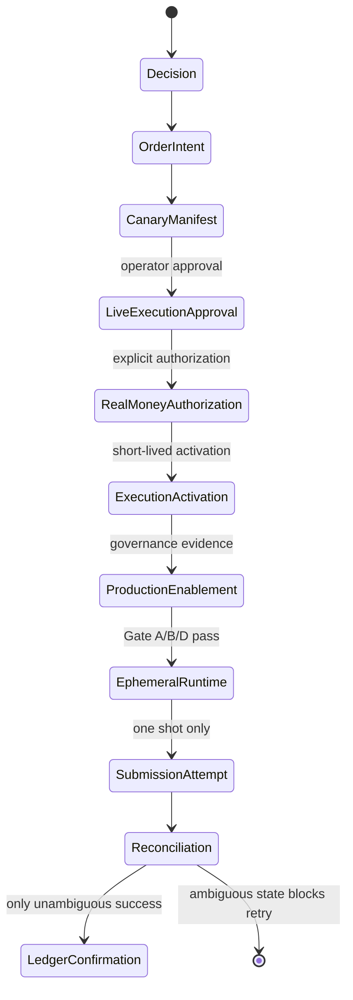

# Controlled Live Execution Architecture Audit

## Scope and safety boundary

This audit covers the V1 controlled, one-shot Bybit Spot `BTCUSDT` execution
path. No execution command, order endpoint, ledger confirmation, or live
mutation is part of the audit or repair. The checked-in execution policy remains
fail-closed (`live_execution_enabled=false`, `kill_switch=true`, and
`order_submission=not_implemented`).

## Baseline inventory (before repair)

The persisted artifact chain is:

```text
Decision
  -> OrderIntent
  -> CanaryManifest
  -> LiveExecutionApproval
  -> RealMoneyAuthorization
  -> ExecutionActivation
  -> ProductionEnablement
  -> Gate D / ephemeral runtime verification
  -> submission attempt / reconciliation
```

`canary-approve` now creates the canonical `LIVE_EXECUTION_APPROVAL`, while
also retaining a legacy `LIVE_APPROVAL` sidecar for operations/recovery
compatibility. Downstream authorization, activation, and controlled execution
load the canonical artifact. The legacy sidecar is not an independent
authorization boundary.

The main architectural defect is a schema/check-ID boundary mismatch:

* `ProductionEvidence` emits concrete check IDs such as `CANONICAL_LEDGER`,
  `STRATEGY_IDENTITY`, `BYBIT_ACCOUNT`, and `FILESYSTEM_DURABILITY`.
* `ProductionEnablement.REQUIRED_EVIDENCE` asks for manually projected boolean
  names, including `ledger_valid`, `v1_strategy_valid`, `canonical_ci_healthy`,
  `production_shadow_healthy`, and `watchdog_healthy`.
* `_gate_d_evidence()` maps several of those names to stale or nonexistent IDs
  (`LEDGER_INTEGRITY`, `V1_STRATEGY`, `BYBIT_ACCOUNT_IDENTITY`,
  `CANONICAL_CI`, `PRODUCTION_SHADOW`, and `WATCHDOG`). Missing IDs become
  `False`/`UNAVAILABLE`, so the failure can look like an operational safety
  failure when it is actually integration drift.

The source also contains a second TTL contract in legacy `LiveApproval` (five
minutes) while the canonical `LiveExecutionApproval` contract is ten minutes.
The intended canonical TTLs are 30 minutes for the canary manifest, ten
minutes for live execution approval, ten minutes for real-money authorization,
and five minutes for execution activation.

## Guardrail classification

| Control | Classification | Reason |
| --- | --- | --- |
| V1 strategy and exact order identity | A — essential safety | Prevents execution of an unintended strategy, symbol, side, type, or amount. |
| Monthly cap and remaining budget | A — essential safety | Prevents monthly spend violation. |
| Account identity, account mode, credential scope, withdrawal disabled | A — essential safety | Binds approval to the intended account and excludes withdrawal capability. |
| No liabilities / no borrowing | A — essential safety | Prevents margin or debt exposure. |
| Spot USDT availability and BTCUSDT instrument constraints | A — essential safety | Prevents an invalid or unfunded spot order. |
| Clock freshness and reconciliation/duplicate state | A — essential safety | Prevents stale authorization and ambiguous duplicate submission. |
| Immutable artifact and SHA/commit binding | A — essential safety | Prevents substitution or mutation between ceremony stages. |
| Explicit approval, authorization, and activation | A — essential safety | Preserves human intent and one-shot execution boundaries. |
| `CANONICAL_CI`, `PRODUCTION_SHADOW`, and `WATCHDOG` | E — not an order-level blocker | These are workflow/monitoring concepts, not emitted financial-safety evidence in the current production evidence bundle. They should be surfaced as health warnings unless a deterministic source is introduced. |
| `LiveApproval` beside `LiveExecutionApproval` | F — consolidate | Keep only as a compatibility receipt for legacy operations; the canonical execution chain must consume `LiveExecutionApproval`. |
| Gate A/B/D projections | F — consolidate | Preserve distinct trust-boundary checks, but consume one canonical evidence registry rather than invented names. |

## Repair target

The repair will establish one registry of emitted readiness check IDs, project
only those IDs into enablement, treat monitoring-only health as warnings, and
make `live-readiness --json` report the complete persisted chain and exact
blockers without creating or authorizing anything. Runtime artifact directory
coverage and the four canonical ceremony TTLs will be tested against drift.

## State diagram



## Repair completed

The implementation now has a single `ReadinessCheckId` registry for the
production-evidence IDs and a single projection boundary for Gate D. The
projection uses the IDs actually emitted by `ProductionReadinessService`:
`CANONICAL_LEDGER`, `STRATEGY_IDENTITY`, `BYBIT_ACCOUNT`,
`BYBIT_CREDENTIAL_SCOPE`, `BYBIT_LIABILITIES`,
`BYBIT_SPOT_AVAILABLE_BALANCE`, `BYBIT_INSTRUMENT`, `CLOCK_SKEW`,
`UNRESOLVED_OPERATIONS`, and `ARTIFACT_INTEGRITY`. The former nonexistent
`LEDGER_INTEGRITY`, `V1_STRATEGY`, `BYBIT_ACCOUNT_IDENTITY`, `CANONICAL_CI`,
`PRODUCTION_SHADOW`, and `WATCHDOG` translations are no longer used.

CI, scheduled Production Shadow, and watchdog remain valuable operational
health signals in their existing monitoring workflows, but are not represented
as fabricated local production-evidence checks for the order-level Gate-D
projection. Financial controls remain hard blockers: config safety, strategy
and exact order identity, ledger/budget, repository/artifact integrity,
account identity/mode, credential scope, withdrawal exclusion, liabilities,
Spot availability, instrument constraints, clock, reconciliation, and
duplicate prevention.

`live-readiness --json` is now the single read-only persisted-chain report. It
shows every ceremony artifact, fail-safe runtime policy, exact blockers, and the
next allowed preparation/authorization command. It performs no network write,
does not construct a submission transport, and never creates authorization,
activation, enablement, or ledger state.

TTL definitions are centralized in `ttl_policy.py` and imported by the canary,
approval, authorization, and activation modules. The tested contract is:
30m / 10m / 10m / 5m respectively. All runtime artifact directories are
explicitly ignored and covered by a regression test.

## Supported operator flow

```text
btc-dca live-readiness --json
btc-dca canary-prepare ...
btc-dca canary-approve ...
btc-dca live-authorize ...
btc-dca live-activate ...
btc-dca production-enable-prepare ...
btc-dca canary-execute ...
```

The final command remains blocked by the checked-in policy in this repository;
the runtime capability is only derivable from a separate verified ceremony and
never changes the committed configuration.

## Validation

The focused architecture/enablement/CLI tests pass. The full suite passes 554
tests, and `scripts/post_codex_validate.sh` passes. No real order, real-money
authorization, activation, or ledger mutation was created during the audit.

